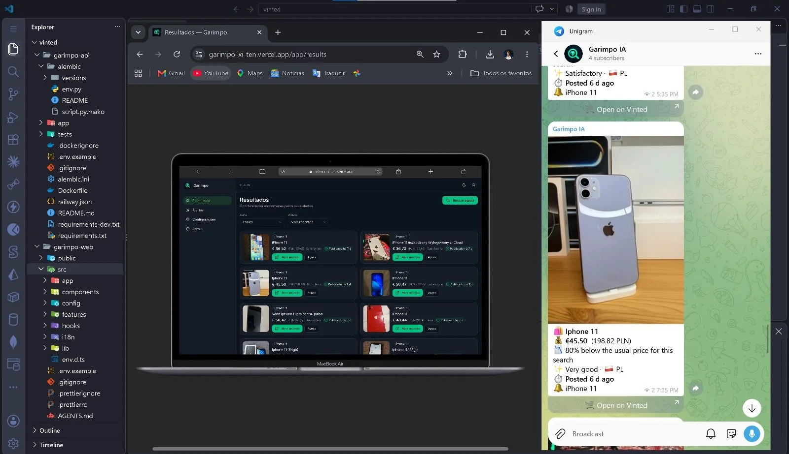
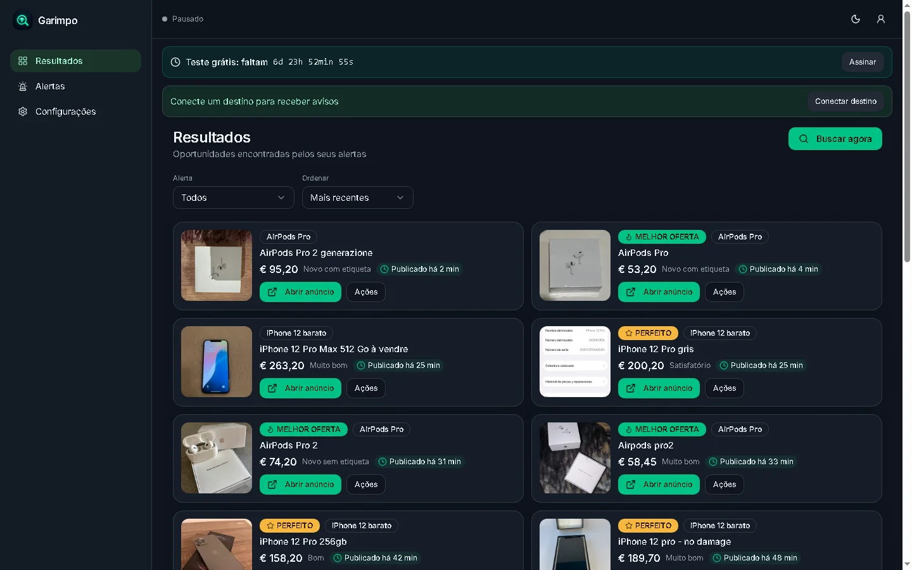
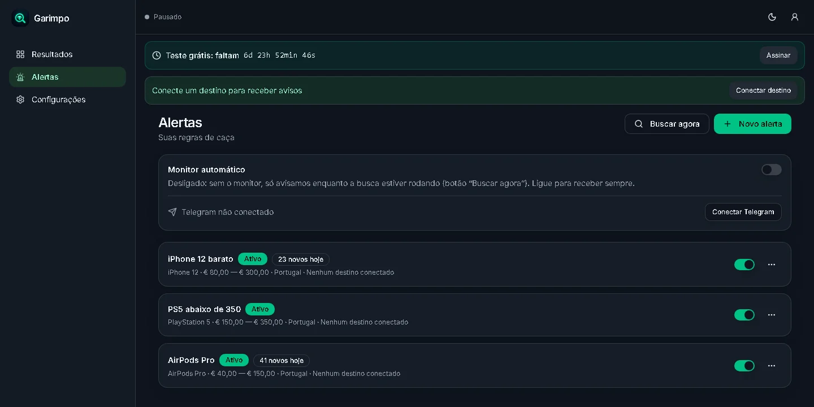

# Garimpo — real-time Vinted alerts

[](https://github.com/anderson-fullstack-developer/vinted/actions/workflows/ci.yml)


Garimpo watches new Vinted listings for you and sends the ones that match your filters straight to Telegram, seconds after they are posted.

**Live demo:** [garimpo-xi-ten.vercel.app](https://garimpo-xi-ten.vercel.app)

Each user creates alerts (search term, price range, country, excluded words, item condition). A background monitor groups the searches, fetches new listings, applies every alert's rules, removes duplicates and notifies the alert's Telegram destination.



## Screenshots

| Results | Alerts |
|---|---|
|  |  |

## Features

- Accounts with email verification and password reset
- Alerts with filters: search term, phrase or all words, price range in EUR, country, excluded words and presets, item condition
- Background monitor that runs inside the API and pauses on Vinted rate limits (429), backing off from 1 to 15 minutes
- Deduplication: one match per alert and listing, one notification per user and listing
- Telegram notifications through a central bot, with titles translated to Portuguese
- Price history per listing, a "Perfect" tag when the price falls in the alert's ideal range and a "Best deal" tag on the cheapest results
- Subscriptions with Stripe (Garimpo Pro) and a free trial
- 200 automated tests (Pytest), run on every push by GitHub Actions together with lint, type checking and the web build

## Architecture

```text
garimpo-web (Next.js 16)  ──/api proxy──▶  garimpo-api (FastAPI)  ──▶  PostgreSQL (Neon) / SQLite locally
                                                 │
                                                 ├─ monitor thread ──▶ Vinted search pages
                                                 ├─ Telegram bot (webhook)
                                                 └─ Stripe (checkout + webhook)
```

- The browser only talks to the Next.js domain: `/api/*` is proxied to the API, so cookies stay first-party and there is no CORS.
- Each cycle makes **one** request per distinct search (country, term, pages), however many alerts share it.
- On an alert's first run the existing listings are recorded as a baseline and not sent, unless "notify on first run" is enabled.

| Folder | What it is |
|---|---|
| [`garimpo-api/`](garimpo-api) | FastAPI backend: auth, alerts, monitor, Telegram, Stripe, Alembic migrations, tests |
| [`garimpo-web/`](garimpo-web) | Next.js front-end, with a mock mode that runs without the API |

## Tech stack

**Front-end:** Next.js 16 · React · TypeScript · Tailwind CSS  
**Back-end:** Python 3.12 · FastAPI · SQLAlchemy · Alembic · Pytest  
**Data:** PostgreSQL (Neon) · SQLite for local development  
**Integrations:** Telegram Bot API · Stripe · Resend  
**Deploy:** Vercel (web) · Railway (API, Docker) · Neon (database)

## Running locally

API (port 8000):

```bash
cd garimpo-api
python -m venv .venv
.venv/Scripts/python -m pip install -r requirements-dev.txt   # Linux/Mac: .venv/bin/python
cp .env.example .env
.venv/Scripts/python -m uvicorn app.main:app --port 8000
```

Web (port 3000):

```bash
cd garimpo-web
cp .env.example .env.local
# NEXT_PUBLIC_USE_MOCK=true runs with fake data and no API.
# To use the API: NEXT_PUBLIC_USE_MOCK=false and API_PROXY_TARGET=http://localhost:8000
npm install
npm run dev
```

Tests:

```bash
cd garimpo-api
.venv/Scripts/python -m pytest
```

More detail in [`garimpo-api/README.md`](garimpo-api/README.md) and [`garimpo-web/README.md`](garimpo-web/README.md).

## Known limitations

- Vinted has no public API. The app reads the listings embedded in the search page, so a change to that page breaks the extractor; the monitor then logs a `FormatChangedError` instead of producing bad data.
- Automated access may go against Vinted's terms of use. This is a personal project, not a commercial service.

## Author

**Anderson Neto**, Full-Stack Developer in Lisbon. [Portfolio](https://andersonneto.gt.tc) · [LinkedIn](https://linkedin.com/in/anderson-fullstack-developer)

## License

[MIT](LICENSE)
